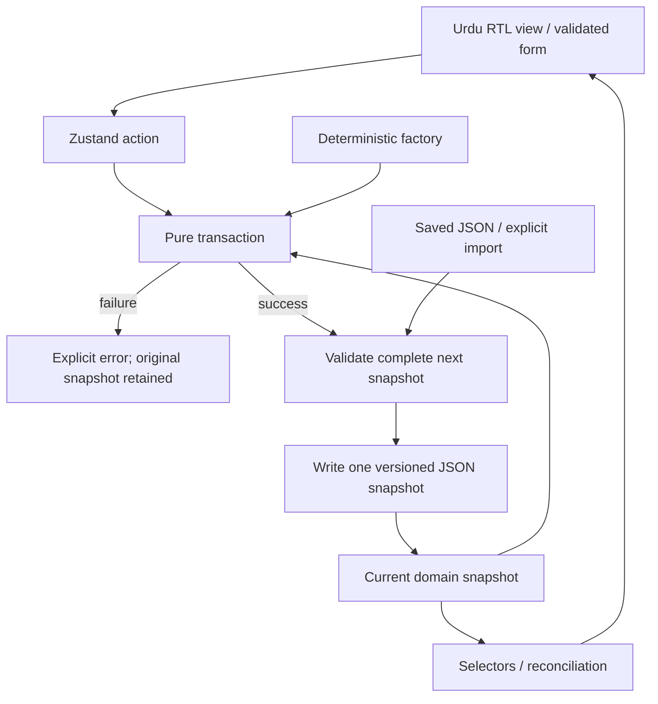

# Noor Textiles ERP architecture

## Scope and business boundary

نور ٹیکسٹائلز لاہور is one fictional company based in Azam Cloth Market, Lahore. The product is an Urdu RTL frontend demonstration of ladies' unstitched fabric manufacturing and wholesale distribution. Phase 1 supplies the domain foundation, three inventory transactions, local demo persistence, route registry and a small operational architecture interface. It does not implement future operational modules.

The end-to-end traceability chain is purchase order → goods receipt → fabric lot → processing challan → processing receipt → approved design/BOM → production work order → cutting/optional embroidery → inspection/assembly → packaging → finished SKU → sales order/reservation → dispatch → invoice → payment allocation. Each document remains distinct and references stable parent IDs.

## Decisions made before implementation

1. Preserve `AGENTS.md`; initialize Vite because inspection found no application to preserve.
2. Use React and strict TypeScript with feature-oriented presentation and framework-independent domain functions.
3. Represent the single company and related collections in one normalized application snapshot. Persist only domain data; dialog visibility, diagnostics scenarios and temporary form input are transient.
4. Derive physical balances from immutable posted inventory movements. A stock quantity field on a product or lot is never independently editable authority.
5. Use canonical meters for fabric length and integer paisa for money. Preserve original purchasing units and actual roll lengths.
6. Execute each transaction as validation followed by one immutable success snapshot, or an explicit failure with no state change.
7. Prevent repeat posting using source IDs, document statuses and movement identity. Preserve history; future cancellations require compensating movements.
8. Build the golden dataset through the same foundation transactions used by the diagnostics scenario. Do not independently seed contradictory balances.
9. Use one localStorage key, `noor-textiles-erp-demo-v1`, containing a schema-versioned serialized snapshot. Invalid saved or imported data must not silently replace valid user data.
10. Give future routes honest Urdu development notices and proposed phase numbers. A demo role switcher is a presentation aid, not authentication or security.

## Layers and ownership

| Layer | Responsibility | Must not do |
| --- | --- | --- |
| `app`, `routes` | Providers, router, route metadata and app composition | Implement stock calculations |
| `components` | Reusable RTL layout, forms, feedback and shadcn/ui controls | Create disconnected domain datasets |
| `features` | Dashboard, diagnostics, settings and future feature presentation | Mutate persisted collections directly |
| `domain` | Entity contracts, units, money, invariants and deterministic calculations | Depend on React, browser storage or random IDs |
| `services` | Transaction boundaries, numbering and storage validation | Hide unsupported transactions behind false success |
| `store` | Central Zustand domain snapshot, actions and selectors | Treat UI state as business authority |
| `data` | Stable fixture identities and deterministic seed/factory generation | Run append-only seed insertion on every refresh |
| `locales`, `lib` | Central Urdu labels and display formatting | Change canonical stored quantities |
| `tests` | Business invariants, persistence boundaries and RTL interaction | Replace real command verification with claims |

Only meaningful Phase 1 modules are physically created. Later features include company, suppliers, fabrics, purchasing, grey inventory, contractors, processing, collections/designs, embroidery, production, cutting, quality control, suit assembly, packaging, finished inventory, customers, pricing, quotations, sales, dispatch, invoicing, payments, returns, expenses, costing, accounting, reports, staff, notifications and audit.

## Data flow

The inventory inspector uses a separate resettable in-memory scenario produced by the same factory. Its actions demonstrate valid source documents without reposting the already-posted golden history in the persisted main store.

## UI, routes and localization

The HTML document declares `lang="ur"` and `dir="rtl"`. Noto Naskh Arabic is bundled locally through `@fontsource` in regular, semibold and bold weights; the app does not depend on a remote font API. Navigation, page layout and tables follow RTL flow; document codes, emails and technical identifiers use explicit LTR rendering. Shared locale messages keep repeated labels consistent. `Intl` displays PKR amounts using `ur-PK`, dates in `Asia/Karachi`, and operational quantities with readable Latin digits and up to four decimal places. PKR, dates and quantities are display concerns and do not alter stored ISO timestamps, integer money or canonical lengths.

The route registry owns path, title, module and proposed implementation phase metadata. `/dashboard`, `/diagnostics`, `/modules` and `/settings` are the four working foundation pages; later modules render an explicit Urdu under-development page. The module page is a navigable route catalogue, not an operational implementation of future modules. The responsive shell provides navigation and company identity without implying that future CRUD modules are available.

## Persistence and failure policy

The store seeds only when saved data is absent. Each successful persisted action writes one complete snapshot using the envelope `{ schemaVersion: 1, revision, data }`. Export downloads domain JSON; import validates schema and relationships before replacement. Reset is an explicit user action restoring the deterministic golden state. Corrupt or unsupported saved data is surfaced and protected from silent overwrite while a warned seed view is displayed; the user can explicitly recover through reset/import. Before writing, the store compares the last loaded serialized snapshot with the currently saved value to detect a stale tab. A failed write does not update domain memory. See [demo data strategy](DEMO_DATA_STRATEGY.md).

localStorage's individual `setItem` operation is not a database transaction. It offers neither concurrent-tab locking, cross-tab compare-and-swap, server validation nor crash durability guarantees. Two open tabs can overwrite each other's snapshots. Browser quota/privacy restrictions may prevent writes. The architecture is suitable for a local demonstration, not production stock or financial custody.

## Security and intentionally deferred work

No server, remote API, multi-company tenancy, real authorization, secure authentication, tax integration, live payment gateway or real-time warehouse synchronization is provided. A role selection changes the demonstration context only. Financial entities are contracts for later phases; the three foundation inventory transactions do not post fictitious invoices, supplier payments or accounting entries.

Future phases must reuse these entities, transaction boundaries, store and route metadata, and add tests for each new critical transaction before exposing it in the UI. Business plans and typed contracts are not completed operational features.

## Phase 2 UI extension

The authorized Phase 2 is the Urdu RTL design system, replacing the earlier provisional master-record Phase 2 handoff. `useUIStore` now persists theme/sidebar/groups/page-size/demo-role preferences under `noor-textiles-erp-ui-v1`, separately from the unchanged version-1 domain envelope. The live ERP instance mirrors theme/role for compatibility; independent store factories retain Phase 1 behavior. Notifications/search/dashboard are pure domain projections. The single example form record and toast messages are transient UI data, and file previews never enter domain storage. See [design system](DESIGN_SYSTEM.md) and [component library](COMPONENT_LIBRARY.md).

## Phase 3 historical extension

The shared DomainState now accepts an optional strictly validated historical extension (history version 3, seed identity noor-expanded-2026-v1) while retaining the schema-version-1 envelope and original base maps. Existing saved data is never implicitly replaced or rewritten. The opt-in lazy seed builder replays public meter transactions, then attaches source-linked historical production/finished-count/wholesale/financial snapshots and validates the complete state before one persistence commit. These snapshots do not expose future CRUD/posting operations.

Fabric balances deduct historical material allocations; reconciliation explicitly accounts for embedded materials, WIP and cutting waste. Finished suits have a separate count-movement history with packaging/dispatch/damage provenance; active reservations affect availability only. Invoice totals come from dispatch-linked lines, and receipts reduce outstanding through explicit allocations. Pure reporting selectors are cached by immutable snapshot/filter key; operational alerts are dated against the seed reporting date. See [expanded data](EXPANDED_DEMO_DATA.md), [analytics](DASHBOARD_ANALYTICS.md), [reconciliation](SEED_RECONCILIATION.md) and [acceptance](PHASE_3_ACCEPTANCE.md).
# Phase 4 procurement extension

The existing store and pure transaction architecture now supports optional normalized `procurement.version: 4`. `src/domain/entities/procurement.ts` defines Zod contracts; `src/services/transactions/procurement.ts` executes typed commands; `src/services/validation/procurement.ts` verifies source references, statuses, units, money and accounting effects. Existing core PO/GRN/lot/roll/movement maps remain authoritative. `src/features/purchasing` composes the existing design system and calls only store-coordinated transactions. Shared procurement, report, search and alert selectors project the same state. No backend or disconnected business store was introduced.

The schema-1 envelope and history version 3 remain compatible through an additive optional field; no destructive migration or initialization repost occurs. Historical provenance and previous seed definitions remain unchanged. [Workflow and limitations](PURCHASING_WORKFLOW.md) supersede earlier proposed Phase 4 scope: company CRUD and grey warehouse transfers/adjustments are excluded from the user's current purchasing brief.

## Phase 5 warehouse extension

The optional strict `warehouse.version: 5` stores location hierarchy profiles, transfer/putaway documents, reservation profiles, stocktakes/count lines, adjustments, quality holds and audit evidence. Existing locations, lots, rolls, reservations and the single meter movement ledger remain authoritative. Quantities and valuations are projections rather than separately editable stock totals. New source-backed paired/signed effects are validated against their documents; existing reducers add identified roll references for future processing integration while preserving old unassigned history.

`src/services/inventory/warehouse.ts` supplies shared portion, custody, valuation, scope and independent reconciliation helpers. `src/services/transactions/warehouse.ts` is the pure command boundary; `src/services/validation/warehouse.ts` validates full-state evidence. Lazy `src/features/warehouse` screens reuse the design system, shared store, CSV and A4 print components. React/router vendor splitting keeps the initial entry below the previous enlarged-bundle warning threshold. New roll/lot/location projections index balances once per call and paginate the existing 800-roll history.

No initialization migration rewrites movements or resets storage. Known roll operations must preserve identity; historical incomplete measurements/unassigned issues use explicitly unknown individual custody and exact aggregate lot balances. See [roll model](ROLL_TRACKING_MODEL.md), [warehouse workflow](GREY_WAREHOUSE_WORKFLOW.md) and [Phase 5 acceptance](PHASE_5_ACCEPTANCE.md). The supplied brief supersedes earlier proposed numbering: full processing management is Phase 6.
