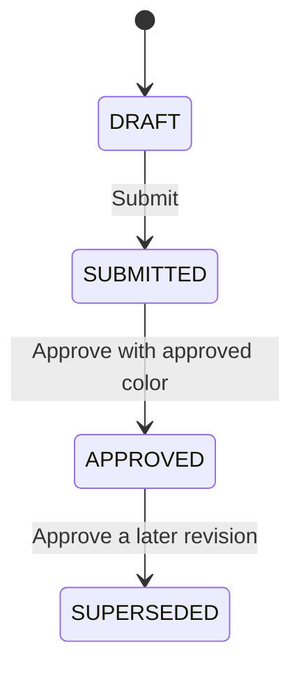

# BOM and revision rules

BOMs are normalized revision documents in `studio.boms`, linked to the existing core design and one operational color variant. Each has unique ID/number, per-variant integer version, effective date, reason, optional previous revision, status and structured component lines. The historical BOM maps remain unchanged.

Each fabric line records component, fabric master, optional exact lot, quantity per suit in meters, wastage percentage, color policy, optional integer-paisa rate, cost-source label and notes. Fabric width/composition come from the actual selected fabric master. Different components can use different masters, widths, lots and colors. `MATCH_VARIANT` requires the actual processed color/code and specified shade; `ANY` is an explicit component-level choice for contrast/plain fabric, not automatic color substitution.

Two-piece requires shirt and trouser; three-piece additionally requires dupatta. Shirt may be one complete line or front + back + sleeves, never both representations. Additional embroidery/border/lace/button/label/packaging components are optional. Fabric is measured in canonical meters. Accessories use whole pieces/sets, are explicitly availability-untracked, and create no accessory inventory. Duplicate line keys, negative/zero consumption, incompatible units, missing fabric/lot references and invalid suit configurations fail validation.

Only draft revisions can be edited. One draft/submitted revision per variant prevents competing drafts. Creating a later draft retains the current approved revision. Approval of the new version supersedes the previous current approval and records a new immutable approval snapshot. Previous lines, dates, reason and version remain accessible via the revision selector and `?bom=<id>`. Import/reload validation compares approved/superseded content with its approval snapshot. Submitted revisions have no withdrawal command in this phase.

Do not edit an approved BOM to update rates or materials. Create a new draft with an explicit reason. Samples retain the exact BOM ID; a V1 sample does not approve V2. Future production must reference the immutable approved BOM ID/version, not a live “latest BOM” pointer. Current design approval also captures the approved BOM IDs, so silently changing its approved version is invalid.
