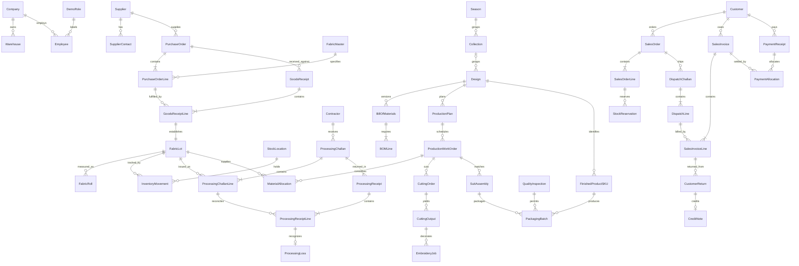

# Data model

## Shared conventions

The source of truth is `src/domain/entities/` and `src/types/common.ts`. Each persistent entity extends `EntityMeta` or `DocumentMeta`: `id`, ISO `createdAt`/`updatedAt`, `createdBy`/`updatedBy`, explicit `status`, and `origin: SEED | USER`. Documents additionally have a human-readable `number`. IDs are stable string aliases (`EntityID`, `CompanyID`, `FabricLotID`, `RollID`); changing a display number must not change foreign keys. Collections are normalized ID-keyed maps, and parent `lineIds` must agree with each line's parent ID.

`Quantity` is a number validated at the unit/transaction boundary. Fabric uses meters at four decimal places; `Money` is a safe integer count of PKR paisa. `DateString` stores ISO timestamps or validated ISO calendar dates for document dates. `DocumentNumber` is a display string. The aliases make intent clear but are not runtime validation; Zod and domain invariants supply runtime checks.

`TransactionStatus` defines `DRAFT`, `APPROVED`, `POSTED`, `PARTIALLY_RECEIVED`, `COMPLETED`, `CANCELLED`, `REVERSED`. Master entities usually use `ACTIVE`/`INACTIVE`. Entity-specific unions narrow statuses where appropriate. These shared contracts do not mean that every future transition is implemented; workflow states such as a future invoice being paid need document-specific refinement in that phase.

Exactly one company is permitted in the snapshot's `companies` map. All warehouses and employees belong to it; there is no tenant switcher or per-company partition. Derived projections such as `InventoryBalance` are not persistent entities and intentionally have no editable metadata.

The current `DomainState` persists the following 25 normalized collections: `companies`, `employees`, `roles`, `warehouses`, `locations`, `suppliers`, `fabrics`, `lots`, `rolls`, `purchaseOrders`, `purchaseOrderLines`, `goodsReceipts`, `goodsReceiptLines`, `contractors`, `challans`, `challanLines`, `processingReceipts`, `processingReceiptLines`, `processingLosses`, `movements`, `reservations`, `customers`, `designs`, `finishedSKUs`, `activityLogs`. `reservations` is empty in Phase 1; imported reservation postings are rejected because their transaction workflow is not implemented. Other catalogue entities below are typed future contracts and are not silently accepted as persisted data. Optional foreign keys to unavailable collections are rejected until a deliberate schema extension adds them.

## Company and people — `entities/company.ts`

| Entity | Important fields beyond metadata | Relationships and meaning |
| --- | --- | --- |
| Company | name, city, address, currency `PKR`, locale `ur-PK` | Exactly one company; no multi-company tenancy |
| Warehouse | companyId, name | Belongs to Company |
| WarehouseLocation | warehouseId, name, code | Descriptive physical subdivision of Warehouse |
| Department | companyId, name | Belongs to Company |
| Employee | companyId, name, roleId, optional departmentId | References Company, DemoRole and optionally Department |
| DemoRole | name, permissionKeys | Demonstration capabilities only; not an authorization boundary |
| DemoPermission | key, label | Named capability contract for role permission keys |
| ActivityLog | actorId, action, documentId, detail | Trace of action actor and stable source document |

## Purchasing — `entities/purchasing.ts`

| Entity | Important fields beyond metadata | Relationships and meaning |
| --- | --- | --- |
| Supplier | name, city, phone, openingBalancePaisa | Trade partner; seed opening balance is zero |
| SupplierContact | supplierId, name, phone, optional email | One supplier may have many contacts |
| FabricMaster | name, composition, widthInches, inventoryUnit `METER`, optional specificationId | Shared fabric identity; specification reference is explicit |
| FabricSpecification | fabricId, gsm, weave, widthInches, shrinkagePercent | Technical specification belongs to FabricMaster |
| FabricRoll | lotId, label, packagingUnit, actualLengthMeters, originalUnit, originalLength | Roll/thaan stores its own measured length; belongs to FabricLot |
| PurchaseRequest | requestedById, fabricId, quantityMeters, requiredOn | Requester and fabric references; future request workflow |
| PurchaseOrder | supplierId, lineIds, orderDate | Header separate from multiple item lines |
| PurchaseOrderLine | purchaseOrderId, fabricId, quantityMeters, originalQuantity, originalUnit, conversionMetersPerUnit, unitPricePaisaPerMeter | Keeps canonical meters and original commercial unit/conversion |
| GoodsReceipt | purchaseOrderId, warehouseLocationId, lineIds, receivedOn | Posting source tied to approved order and stock destination |
| GoodsReceiptLine | goodsReceiptId, purchaseOrderLineId, lotId, quantityMeters, originalQuantity, originalUnit, conversionMetersPerUnit | Links incoming lot to exact PO line |
| SupplierInvoice | supplierId, goodsReceiptIds, totalPaisa, dueOn | A payable document, distinct from receipt and payment |
| PurchaseReturn | supplierId, goodsReceiptLineId, quantityMeters, amountPaisa, reason | References original received fabric |
| SupplierPayment | supplierId, amountPaisa, allocations, paidOn | Allocations explicitly name supplier invoices and paisa amounts |

`FabricRoll` has one definition, reused by purchasing and inventory. Roll count is not multiplied by an assumed standard length. Goods receipt's `warehouseLocationId` is the ID of the inventory `StockLocation` used by the current transaction engine; the separate `WarehouseLocation` contract is available for later physical subdivisions. Later phases must retain a clear mapping if both are populated.

## Inventory — `entities/inventory.ts`

| Entity | Important fields beyond metadata | Relationships and meaning |
| --- | --- | --- |
| FabricLot | code, fabricId, supplierId, sourceGoodsReceiptLineId | Stable provenance from a receipt line to fabric and supplier |
| StockLocation | name, optional warehouseId/contractorId, category | Warehouse or contractor custody location; location/category must agree |
| InventoryMovement | sourceType, sourceDocumentId, sourceLineId, lotId, optional rollId, locationId, category, signed quantityMeters, occurredAt, optional contractorId | Immutable posted quantity effect tied to a source line |
| InventoryBalance | lotId, locationId, category, onHandMeters, reservedMeters, availableMeters | Derived projection; never an editable stock authority |
| InventoryReservation | lotId, locationId, category, quantityMeters, sourceDocumentId | Future allocation hold reduces availability, not physical stock |
| StockAdjustment | lotId, locationId, category, quantityMeters, reason, approvedById | Future explained gain/loss with approval |
| StockTransfer | lotId, fromLocationId, toLocationId, category, quantityMeters | Future warehouse transfer with paired movements |
| FinishedInventoryMovement | skuId, packagingBatchId, locationId, category, quantitySuits, unit `SUIT`, sourceDocumentId/sourceLineId, sourceType, occurredAt | Future count ledger; categories FINISHED_GOODS/REJECTED/DAMAGED; source packaging, dispatch, return or reversal |
| CutComponentInventoryMovement | cuttingOutputId, workOrderId, locationId, category, component, quantityPieces, unit `PIECE`, sourceDocumentId/sourceLineId, sourceType, occurredAt | Future component ledger; categories CUT_COMPONENT/REJECTED/DAMAGED; source cutting, assembly consumption or reversal |
| FinishedInventoryBalance | skuId, locationId, onHandSuits, reservedSuits, availableSuits, unit `SUIT` | Future derived projection distinct from fabric-meter balances |
| CutComponentInventoryBalance | cuttingOutputId, locationId, onHandPieces, reservedPieces, unit `PIECE` | Future derived component projection |

`MovementSourceType` currently permits `GOODS_RECEIPT`, `PROCESSING_ISSUE`, `PROCESSING_RECEIPT`, `PROCESSING_LOSS`. Categories reserve GREY, PROCESSING_OUT, PROCESSED, PRODUCTION_WIP, CUT_COMPONENT, FINISHED_GOODS, REJECTED and DAMAGED. Phase 1 movements are fabric-length movements; distinct future suit/component movement contracts keep counts out of the meter ledger. They must be added to persistence with tested posting operations in their respective phases. A catalogued SKU does not authorize a fabricated finished-stock movement.

## Processing — `entities/processing.ts`

| Entity | Important fields beyond metadata | Relationships and meaning |
| --- | --- | --- |
| Contractor | name, city, phone, services | Contractor service capabilities |
| ContractorService | contractorId, serviceType | Named service relationship |
| ProcessingRate | contractorServiceId, fabricId, ratePaisaPerMeter, effectiveFrom | Effective service price for compatible fabric |
| ProcessingJob | contractorId, serviceType, challanIds | Groups one or more challans |
| ProcessingChallan | contractorId, fromLocationId, contractorLocationId, serviceType, lineIds, optional jobId | Header defines source/custody destination; can contain multiple lots |
| ProcessingChallanLine | challanId, lotId, quantityMeters | Issued quantity for one lot |
| ProcessingReceipt | challanId, destinationLocationId, lineIds | Many receipts may reference the same challan |
| ProcessingReceiptLine | processingReceiptId, challanLineId, outputMeters, lossMeters, lossReason, optional lossApprovedById | Output and approved loss are distinct, linked to the issued line |
| ProcessingLoss | receiptId, receiptLineId, challanId, challanLineId, lotId, quantityMeters, reason, approvedById | Explicit posted loss; never inferred from an unreturned balance |
| ProcessingCharge | receiptId, contractorId, serviceType, quantityMeters, unitRatePaisa, totalPaisa | Future service costing record, independent of physical receipt |

Services are BLEACHING, DYEING, DIGITAL_PRINTING, ROTARY_PRINTING, SCREEN_PRINTING and FINISHING. Remaining contractor custody is issued minus physically returned output minus approved loss. A partial receipt does not require reducing the original issued quantity.

## Design and manufacturing — `entities/production.ts`

| Entity | Important fields beyond metadata | Relationships and meaning |
| --- | --- | --- |
| Season | name, year | Commercial season |
| Collection | name, seasonId | Groups designs within a season |
| Design | code, name, pieceCount `2|3`, imagePath, optional collectionId/bomId | Approved design references a versioned BOM when production becomes active |
| DesignColorVariant | designId, name, colorHex | Design-specific color identity |
| DesignSample | designId, lotId, approvalNotes | Sample ties design review to real fabric |
| BillOfMaterials | designId, version, pieceCount, lineIds | Versioned consumption requirements |
| BOMLine | bomId, component, fabricId, widthInches, consumptionMetersPerSuit, wastePercent | SHIRT, TROUSER or DUPATTA with independent fabric/width/consumption |
| ProductionPlan | designId, plannedSuits, dueOn, workOrderIds | Planned whole suit output |
| ProductionWorkOrder | productionPlanId, bomId, targetSuits, allocationIds | Freezes BOM relationship and allocated fabric |
| MaterialAllocation | workOrderId, lotId, component, quantityMeters, sourceLocationId, wipLocationId | Reserves/moves material into WIP through a future transaction |
| CuttingOrder | workOrderId, allocationIds, cutterId | Work assignment references allocated source fabric |
| CuttingOutput | cuttingOrderId, component, pieces, consumedMeters, wasteMeters | Separates piece counts from length consumption/waste |
| EmbroideryJob | cuttingOutputId, contractorId, issuedPieces, receivedPieces, chargePaisa | Optional service on traceable components |
| QualityInspection | sourceType, sourceId, inspectedPieces, passedPieces, rejectedPieces, defectIds | Current contract for CUTTING/EMBROIDERY/ASSEMBLY/RETURN sources |
| FabricQualityInspection | lotId, sourceReceiptId, inspectedMeters, acceptedMeters, rejectedMeters, notes | Future fabric inspection contract uses meters separately from piece inspection |
| QualityDefect | inspectionId, code, affectedPieces, disposition | REWORK, REJECT or DAMAGE evidence |
| SuitAssembly | workOrderId, skuId, componentOutputIds, assembledSuits, inspectionId | Traceable matching of components to suits |
| PackagingBatch | assemblyId, inspectionId, skuId, packedSuits, suitsPerCarton, warehouseLocationId | Packaging is the validated boundary before finished goods increase |
| FinishedProductSKU | code, designId, name, pieceCount, unit `SUIT`, optional colorVariantId, catalogueOnly | Product identity; current golden SKU is a catalogue example with zero stock |

Two-piece and three-piece BOMs differ in required components. Different components may use different fabric IDs, widths and meters per suit. `FabricQualityInspection` handles fabric lengths separately from `QualityInspection` piece counts; neither quality workflow is operational in Phase 1.

## Wholesale and accounts — `entities/wholesale.ts`

| Entity | Important fields beyond metadata | Relationships and meaning |
| --- | --- | --- |
| Customer | name, city, phone, openingBalancePaisa | Wholesale trading partner; seed balance is zero |
| CustomerCreditProfile | customerId, creditLimitPaisa, paymentTermDays, holdNewOrders | Credit controls are a future transaction rule |
| WholesalePriceList | name, effectiveFrom, prices | SKU, minimum suit count and unit price entries |
| Quotation | customerId, priceListId, lineIds, validUntil | Commercial proposal, no implicit stock reservation |
| QuotationLine | quotationId, skuId, suits, unitPricePaisa, discountPaisa | Independent proposal line |
| SalesOrder | customerId, optional quotationId, lineIds, requiredOn | Order distinct from shipment, billing and payment |
| SalesOrderLine | salesOrderId, skuId, suits, unitPricePaisa, discountPaisa | Ordered quantity and terms |
| StockReservation | salesOrderLineId, skuId, warehouseLocationId, suits | Finished-suit hold for one order line |
| DispatchChallan | salesOrderId, customerId, lineIds, dispatchedOn | Actual shipment document |
| DispatchLine | dispatchChallanId, salesOrderLineId, reservationId, skuId, suits | Links shipped goods to order and reservation |
| SalesInvoice | customerId, dispatchChallanIds, lineIds, totalPaisa, dueOn | Receivable document; stock movement occurs at dispatch |
| SalesInvoiceLine | salesInvoiceId, dispatchLineId, suits, unitPricePaisa, discountPaisa, totalPaisa | Exact billed shipment relationship |
| PaymentReceipt | customerId, amountPaisa, allocationIds, method, receivedOn | CASH/BANK/CHEQUE demo receipt, no gateway |
| PaymentAllocation | paymentReceiptId, salesInvoiceId, amountPaisa | Applies a portion of receipt to one invoice |
| CustomerReturn | customerId, salesInvoiceLineId, suits, disposition, optional inspectionId, reason | SALEABLE/INSPECTION_HOLD/REJECTED/DAMAGED disposition |
| CreditNote | customerId, customerReturnId, amountPaisa | Approved return credit, not an implicit refund |
| Expense | category, amountPaisa, incurredOn, description | RENT/SALARY/UTILITIES/TRANSPORT/OTHER |
| CostAllocation | sourceDocumentId, targetBatchId, amountPaisa, basis | METERS/SUITS/DIRECT attribution; future validation must prevent over-allocation |
| SupplierLedgerEntry | supplierId, sourceDocumentId, debitPaisa, creditPaisa, transactionId | Future immutable payable ledger entry |
| CustomerLedgerEntry | customerId, sourceDocumentId, debitPaisa, creditPaisa, transactionId | Future immutable receivable ledger entry |
| AccountTransaction | date, description, entries | Account-code debit/credit entries; future posting must balance in paisa |

Nested price entries and account/payment allocation value objects are intentional small owned values; business documents and major line records remain separate entities. Future operational phases may normalize nested values further where independent audit identities are needed.

## Main relationship diagram

The diagram describes intended relationships, not a remote database schema. Phase 1 validates and persists only the active foundation collections. Future types are contracts, not seeded fake transactions. Deletion of referenced records and cancellation of posted records must be resolved through explicit validated operations; a generic destructive CRUD shortcut is not part of the architecture.

## Phase 3 persisted historical contracts

The 25 base maps above remain the original meter/catalogue foundation. DomainState additionally supports optional history, whose strict schema is in src/domain/entities/history.ts. It owns normalized maps for profiles, collections, variants, BOMs/lines, processing schedules/charges, production batches, material allocations/component outputs, packaging, finished suit movements, sales orders/lines/reservations, dispatches/lines, invoices/lines, payments/allocations, supplier invoices and expenses. Each extension entity has stable metadata and the same companyId; uniqueness and foreign keys are checked across both base and extension collections.

Design collectionId/bomId and SKU colorVariantId/non-catalogue status are now allowed only with matching validated extension records. Meter-ledger reservations remain unsupported; suit reservations use the separate historical count contract. Finished suit counts never become meter movements. Historical contracts are reporting evidence, not full executable work-order/QC/accounting workflows. The base envelope version remains 1 and the optional extension is independently versioned. Source relationships, actual counts and limitations are documented in EXPANDED_DEMO_DATA.md.
# Phase 4 operational purchasing model

`DomainState.procurement` is an optional strict version-4 extension within the existing schema-1 storage envelope. Normalized maps are supplierProfiles, fabricProfiles, requests, orderProfiles, orderLines, receiptProfiles, inspectionRolls, bills, billLines, payments, returns and audits. All entries carry stable IDs, company ID, USER provenance and creation/update metadata. Core supplier/fabric/PO/GRN/lot/roll/movement maps are retained.

Profiles store master contact/specification/rate defaults; order terms preserve original unit/count/measured lengths and discounts alongside canonical core lines. Inspection separates accepted roll stock from rejected/quarantined evidence. Bills reference eligible posted receipt quantities; payment allocations reference same-supplier posted bills. Returns reference original GRN line/lot/location and optional known roll; posted returns own compensating movements and derived bill credit. Audits record actor, demo role, timestamp, command, source ID and status transition.

History supplier invoices remain validated snapshots joined in read-only financial selectors. Posted documents are immutable; available historical lots permit only source-valid stock-limited new returns. See [ledger rules](SUPPLIER_LEDGER_RULES.md) and [receiving](GRN_AND_ROLL_RECEIVING.md) for exact financial and stock semantics.

## Phase 5 warehouse model

`DomainState.warehouse` is optional version 5, preserving envelope schema 1 and existing history/procurement extensions. Normalized maps: locationProfiles, transfers, reservationProfiles, stocktakes, stocktakeLines, adjustments, qualityHolds and audits. Hierarchy is optional zone/rack/shelf/bin metadata on the existing location; each profile has warehouse code, purpose, capacity and fabric compatibility. The explicit sample-layout command creates empty location records only.

Transfers hold one or many lot/roll quantity portions. The original roll ID remains stable; current portions derive from identified signed movements. Inspection hold and quarantine join the category enum alongside existing rejected/damaged categories. Quality documents retain original quantity and adjusted/released remainder; hold-linked approved write-offs/gains reconcile with source adjustment events.

Reservations retain the existing base map. When ACTIVE, base quantity is remaining reserved meters; completed/cancelled base records retain a positive original quantity for schema compatibility and are excluded from availability. Profiles retain original/released/consumed meters and exact consuming challan references; UI status distinguishes partial consumption, release, cancellation and completion.

Stocktakes store system snapshots, counted quantities, notes and a scope fingerprint, not replacement balances. Posted variances produce source-linked adjustment documents/movements. Adjustment provenance, source snapshot, approver and optional count/quality-hold references are explicit. New movements include company/fabric/role/reason/endpoints; legacy movements remain unchanged and receive source-derived presentation metadata.

Processing challan lines optionally identify a roll for future integration; old lines remain unassigned. Supplier returns optionally choose the current GREY location after transfer, with unchanged Phase 4 billing/credit rules. No new lots appear without a GRN source. [Movement rules](WAREHOUSE_MOVEMENT_RULES.md) define stock, availability, custody, roll conservation and cost rounding.

## Phase 6 entities

The additive processing extension contains contractor profiles, unit-aware rates, operational jobs, issue/receipt profiles, colors, dye batches/shade approvals, processed outputs, QC decisions, contractor bills and payments. Output metadata links a new core lot to parent/root lots, original GRN, job, receipt line, service stage, color/design and destination quality. Core receipt `outputMeters` is the entire physical returned quantity, including accepted, held and rejected output; it is not accepted quantity alone. New output lots share the original GRN lineage and have explicit processing provenance. The original purchase lot is never overwritten. See [processing rules](PROCESSING_RECEIPTS_AND_LOSSES.md).
