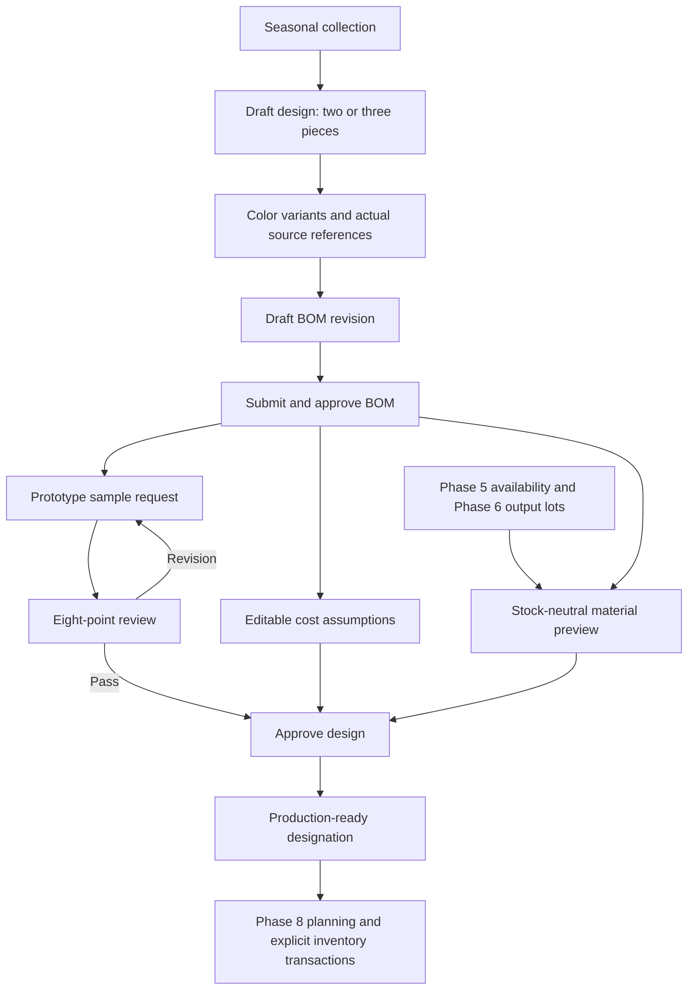

# Phase 7 — Design Studio workflow

The studio defines products and plans materials for Noor Textiles Lahore. It creates no fabric, suits, stock issues, reservations, liabilities or realized profit. Open `/designs`; use the owner or production demo profile to make changes. Other profiles can inspect records and reports. These are simulated permissions.

Create a collection, register a design, add/approve its colors, and save the components in each variant's BOM. Submit and approve the revision before requesting its prototype sample. Submit the sample, review all eight checks, request revision or approve. Resubmission keeps previous reviews. Add cost assumptions and acknowledge any deliberately unpriced items. Approve the design, then explicitly mark it ready.

Design statuses are DRAFT, SAMPLE_REQUESTED, SAMPLE_IN_PROGRESS, UNDER_REVIEW, REVISION_REQUIRED, APPROVED, PRODUCTION_READY, INACTIVE and ARCHIVED. Statuses change through commands, not arbitrary master editing. Approved/ready designs are locked; open revision before changing their planning information. New BOM approvals require a new approved sample for that exact revision. Archiving/inactivation preserves references.

Readiness requires an eligible collection, valid suit/BOM, at least one approved color, an approved current BOM and sample for every approved variant, priced or explicitly acknowledged assumptions, and matching eligible processed material. Full target-quantity availability is **not** required: a ready definition can carry shortages that Phase 8 must resolve. Readiness does not guarantee future stock availability, and alerts show current shortages.

Historical records remain readable with an explicit historical/unverified-approval label. Their original collection, BOM, production and SKU references stay unchanged. Duplicate a historical definition to begin a controlled operational draft; no historical approvals are fabricated. Duplication can copy variant structure and BOM lines, resetting approvals and retaining source design ID. It copies no production or stock.

The catalog supports local CSS illustrations/swatches, cards/table, search, collection/season/suit/status/fabric filters, sorting and pagination. Detail pages provide overview, colors, BOM, samples, costing, availability and activity. Nine reports offer table sorting, date filters, numeric CSV and Urdu print. Six detail documents cover specification, colors, BOM, sample review, estimated costs and material requirements.

Routes and evidence: [Phase 7 acceptance](PHASE_7_ACCEPTANCE.md). Financial/planning assumptions: [costing and availability](DESIGN_COSTING_AND_AVAILABILITY.md).
