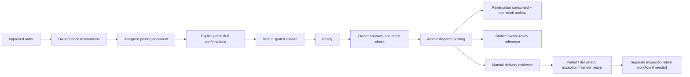

# Dispatch and delivery workflow

`/dispatch`, `/new`, `/:id` implement dispatches; `/dispatch/transport` and `/dispatch/deliveries` manage fictional logistics. A dispatch captures its order/customer/warehouse, exact pick-reservation quantities, original lot/carton references, carrier, vehicle/driver reference, unique consignment, expected date, destination, remarks, preparer and approver. Draft editing creates no movement or receivable.

States are DRAFT -> READY -> APPROVED -> DISPATCHED. Owner approval freezes the source/logistics snapshot and recorded credit evidence. Posting rechecks the approved order/customer, credit eligibility, own confirmed picks, remaining reservations, actual accepted stock and exact carton contents. In one validated state it consumes reservations, appends DISPATCH effects to the existing Phase 9 finished movement map, snapshots partial shipment values, updates order projection, marks complete cartons dispatched, records audit and creates a stable invoice-ready reference. Duplicate posting and over-shipment fail without persistence changes.

An order100 can reserve70, pick40 and dispatch40. It then has60 remaining fulfillment and30 active reservation; availability must not subtract the consumed40 again. Another35 can dispatch only after a further5 reservation/pick joins the remaining30. The order then has25 remaining. Multiple drafts may not overclaim the same picked portions. Posted dispatch cannot be cancelled or undone through a status edit; only an authorized later compensating return workflow may receive goods back.

Transport records and delivery events are manually entered fictional evidence, never live courier tracking. Delivery snapshots record cumulative good received, shortage, damage, receiver, proof and reason. Counts cannot exceed shipment or regress prior good receipts. DELIVERED requires the entire correct quantity and a receiver. Partial counts remain distinct. Shortage/damage and EXCEPTION/RETURNED_TO_SENDER require reasons. Delivered/sender-return terminal records cannot be casually rewritten.

Delivery changes no finished movement, reservation consumption, invoice or payment. Sender-return goods remain outside saleable stock pending actual return receipt and condition inspection. `/sales/returns-preview` exposes discrepancies and that boundary without a fake restock button. Challan, picking and delivery A4 sheets print actual source lines and logistics; printing itself has no inventory effect.
