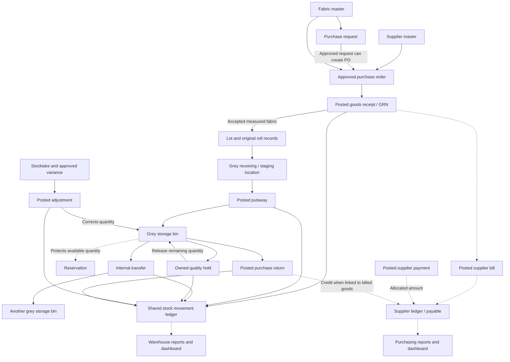
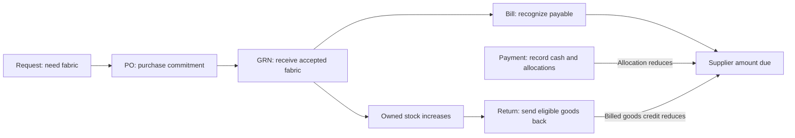
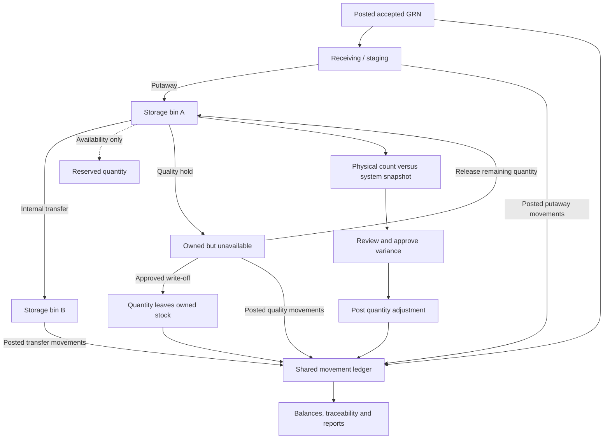

# Noor Textiles ERP — Module Guide Through Phase 5

Updated: 14 October 2026. This is one business guide to what the application currently does, when to use each module, and how the records connect.

## 1. What is complete?

Phases 1–5 cover the application foundation, Urdu RTL interface, connected demonstration history, purchasing and grey fabric warehouse control. You can create and post purchasing and warehouse transactions and keep their results across browser refreshes.

The application is a single-company frontend demonstration for Noor Textiles Lahore. Business records share one central store, saved in this browser's localStorage. Payments record demonstration cash transactions; they do not send money. The selected work profile simulates permissions; it is not a login or authentication system.

| Phase | What it provides | Practical use |
| --- | --- | --- |
| 1 | Architecture, shared records, stock movement rules and diagnostics | Keep transactions connected and verify the original receipt/processing example |
| 2 | Urdu RTL layout, reusable controls, themes, search and print foundation | Navigate and use the same interface consistently across modules |
| 3 | Optional connected historical demo data and advanced dashboard | Explore a realistic business history and its purchasing, manufacturing and sales figures |
| 4 | Suppliers, fabrics and complete purchasing workflows | Order, receive, bill, pay and return purchased fabric |
| 5 | Grey warehouse and inventory control | Locate, reserve, move, inspect, count and reconcile owned grey fabric |

Historical processing, manufacturing and sales records help demonstrate the business. Their presence does **not** mean their full operational editors are complete. Section 9 identifies these boundaries.

## 2. The overall connection diagram

Solid arrows describe document or stock connections. Dashed arrows describe financial, availability or reporting connections. A supplier bill and warehouse receipt are separate documents with different effects.



An accepted receipt can also go directly into a suitable grey location. Staging followed by putaway is the workflow when the receiving area and final storage bin are separate.

## 3. Foundation and everyday navigation

| Module / page | What it is for | How to use it | How it connects |
| --- | --- | --- | --- |
| Dashboard — ڈیش بورڈ (`/dashboard`) | Company overview, stock totals, alerts and historical business analytics | Start here to review figures, apply available filters and open source records | Reads the central business state; the displayed dataset determines which historical analytics appear |
| Global search and notifications | Find records and see items requiring attention | Use Ctrl/Cmd+K or header search; open a result or alert | Links to existing records such as suppliers, purchases, lots and warehouse documents |
| Module catalogue (`/modules`) | Shows which routes are working and which are planned | Check module status and navigate to a page | Describes the registered routes; a catalogue entry alone does not implement a workflow |
| Settings — ترتیبات (`/settings`) | Manage this browser's saved demonstration data | Export JSON, import validated JSON, or explicitly confirm reset/demo-data replacement | Operates on the shared business snapshot; theme and navigation preferences are stored separately |
| Diagnostics (`/diagnostics`) | Demonstrate and check the original three stock transactions | Run receipt, processing issue and partial receipt; inspect reconciliation; reset the scenario | Uses an isolated in-memory scenario, so these actions do not change your saved business records |
| Design system (`/design-system`) | Demonstrate reusable interface components and printing | Explore tables, forms, charts, themes and A4 preview | Shares UI components with operational pages; its example form does not create business records |

To explore the larger historical business, explicitly load the expanded demo from Settings. Export your current data first if you want to keep it. Loading it replaces the business snapshot only after confirmation; it is not an automatic background reset.

## 4. Purchasing modules — Phase 4

### Suppliers — سپلائرز

**Open:** `/suppliers`.

This is the directory of businesses supplying fabric. Store contact details, city, payment terms, opening payable, credit limit and active status. Create or edit a supplier before using it in a purchase order.

The supplier profile collects its orders, receipts, bills, payments, returns and activity. Its ledger opens at `/suppliers/:id/ledger`. Referenced suppliers remain part of history; deactivation is safer than deleting that history. Creating a supplier does not create stock or a new invoice.

### Fabric master — کپڑے

**Open:** `/fabrics`.

This defines *what fabric is*: code, name, composition, category, width, GSM, grade, preferred supplier, default purchasing information and reorder threshold. Use it to maintain consistent fabric identity before purchasing.

Requests, PO lines, receipt lots and warehouse reports refer to the same fabric ID. A fabric master is a catalogue definition; a **lot** is a received batch of that fabric, and a **roll** is an individually measured piece. Updating a default price does not change the price of an old posted purchase.

### Purchase requests — خریداری کی درخواستیں

**Open:** `/purchases/requests`.

Use this when a department needs fabric. Enter the fabric, required quantity, needed date, priority and reason. Save a draft, submit it and obtain approval or rejection. An approved request can be converted into a linked PO once.

A request communicates demand. It does not add inventory or create supplier payable.

### Purchase orders — خریداری آرڈر

**Open:** `/purchases` (dashboard and order register); create at `/purchases/new`.

A PO records the purchase commitment: supplier, fabric lines, quantities, rates, discount, expected date, destination warehouse and terms. Create and edit the draft, then approve it before receiving goods.

Posted accepted receipts update the PO's received quantities. Partial receipt keeps the remaining quantity visible; completing or closing the order ends further receiving. An unreceived order can be cancelled. A PO alone creates neither stock nor a posted bill.

### Goods receipts / GRN — مال وصولی

**Open:** `/purchases/receipts`.

Use a GRN when fabric physically arrives against an eligible PO. Record supplier delivery references, actual roll lengths, units, width, grade, inspection decision and receiving location. A draft lets you prepare the receipt without changing stock.

Posting accepted quantities creates connected lots, roll records and stock movements, and updates the PO's accepted received balance. Rejected or quarantined incoming fabric is inspection evidence and is excluded from available owned stock. It is different from a quality hold placed later on fabric already owned by Noor Textiles.

There is no assumed fixed length for a roll or thaan. Record its actual measurement. Receiving beyond the order's eligible remaining quantity is blocked.

### Supplier bills — سپلائر بل

**Open:** `/purchases/bills`.

Use this to record the supplier's financial bill for eligible posted receipts. Choose receipts from the same supplier and record explicit discount or charges. The current bill workflow uses the full eligible retained, unbilled quantity; it does not provide arbitrary partial-quantity billing.

Posting increases supplier payable and prevents those same goods from being billed again. A bill does not receive goods a second time. Returns posted before billing reduce the quantity eligible for the later bill. Tax is explicitly zero in this demonstration.

### Supplier payments — سپلائر ادائیگیاں

**Open:** `/purchases/payments`.

Record a cash, bank or cheque payment and allocate it to the same supplier's posted bills. Review and post the draft. Allocations cannot exceed a bill's outstanding amount or the payment's cash amount.

The allocated amount reduces payable. Any unallocated cash is shown separately as a supplier advance. Posted payments preserve their history; this phase does not implement payment reversal or later advance allocation.

### Supplier ledger — سپلائر کھاتہ

**Open:** a supplier profile → ledger, or `/suppliers/:id/ledger`.

Use this to answer: “How much do we owe this supplier, and why?” It combines opening balance, posted bills, allocated payments and applicable posted return credits, with a running balance, date filtering, CSV export and A4 printing.

```text
Supplier balance = opening payable + posted bills
                   − allocated posted payments − posted return credits
```

A positive balance is payable. A negative balance is recoverable supplier credit. Unallocated advances are shown separately, so cash paid and bills settled are not confused.

### Purchase returns — خریداری واپسی

**Open:** `/purchases/returns`.

Use this to return available purchased grey fabric to its supplier. Select the original receipt/lot, current location and known roll portion, enter quantity and reason, then approve and post.

Posting removes stock once. Billed goods can create a linked supplier credit; unbilled goods reduce future bill eligibility. A return preserves the original receipt and roll measurements and does not reopen the PO. Reserved, unavailable or processed fabric cannot be returned through this workflow. Release owned quality-held fabric to eligible grey stock before using the existing purchase-return workflow.

### Purchasing dashboard and reports

**Open:** `/purchases`, `/purchases/dashboard`, `/purchases/reports`.

Use these for purchasing commitments, received values, supplier payable, cash payments, advances, delayed orders, due bills and purchase history. Reports cover suppliers, fabrics, months, pending POs, receipts, rolls, outstanding bills, payments, returns, prices and lot reconciliation. Filters, CSV and print help review the underlying records.



**Example:** A PO for 1,000 m receives 400 m and then 350 m. Accepted receipt total is 750 m and order balance is 250 m. If a posted bill is PKR 100,000 and PKR 30,000 is allocated to it, payable is PKR 70,000, assuming no opening balance or other transactions. Extra unallocated cash is an advance, not another bill settlement.

## 5. Grey warehouse modules — Phase 5

### Grey warehouse dashboard — گرے کپڑے کا گودام

**Open:** `/inventory/grey`.

Use this to review physical grey fabric, available fabric, reservations, held/damaged/quarantined quantities, lots, rolls, pending putaway, low stock and contractor custody. Its charts and drilldowns come from actual linked records.

Owned grey fabric on quality hold remains physical stock but is unavailable. Contractor-held and processed quantities are shown separately from warehouse grey stock.

### Lots — لاٹس

**Open:** `/inventory/grey/lots`.

A lot represents an acquired batch with a fabric, supplier, receipt and source cost. Open its detail to see original received quantity, current balances, available/reserved quantity, locations, rolls and movements.

Use lots for batch traceability: “Which supplier receipt brought this fabric, where is it now, and what happened to it?” Many lots can belong to one fabric master.

### Rolls — رولز

**Open:** `/inventory/grey/rolls`.

A roll records an actual original measurement and stable identity. Open its detail to view source, width, grade, current location/quality portions, reservations and movement history, or print its label.

Moving part of a roll keeps its original ID. A 65 m roll can have 45 m in bin A and 20 m in bin B; these are portions of one roll, not two newly received rolls. Its original receipt measurement remains 65 m.

Some historical transactions lack individual roll identities. Those records explicitly show unknown individual custody; this does not mean the lot's stock balance is zero. New operations involving known rolls retain their identities.

### Warehouse locations — گودام کی جگہیں

**Open:** `/inventory/locations`.

Use this to organize existing warehouses into receiving/staging, storage and quality areas, with optional zone, rack, shelf and bin information. Set location capacity, fabric compatibility and active status.

Locations are referenced by receiving, putaway, transfer, reservations and counting. Creating a location adds no stock. An optional sample layout creates empty locations only. Stock-bearing locations cannot simply be deactivated, and historical warehouse/category identity is protected.

### Putaway — وصول شدہ کپڑا رکھنا

**Open:** `/inventory/putaway`.

Use this after receiving accepted fabric into staging. Select the source roll portions and destination storage bin, then submit, approve and post the document.

Posting takes quantity out of staging and puts the same quantity into storage. It changes where fabric is held, without increasing company stock or creating another supplier receipt.

### Internal transfers — اندرونی منتقلی

**Open:** `/inventory/transfers`.

Use this to move eligible grey fabric between active grey locations. Select exact source lot/roll portions, quantity and a compatible destination with sufficient capacity. Submit, approve and post.

The source decreases and destination increases by the same quantity. Reserved stock is protected. Ordinary transfer is not a way to bypass quality holds.

### Reservations — کپڑے کی ریزرویشن

**Open:** `/inventory/reservations`.

Use this to protect fabric for processing, production or sampling. Select the lot, location, known roll where applicable, quantity, purpose and reference.

Reservation reduces available quantity without changing physical stock. Release all or part when the requirement ends, or consume through the supported linked processing-issue transaction. Expiry raises attention; it does not silently release stock. Full processing editors remain for Phase 6.

### Stocktakes — اسٹاک گنتی

**Open:** `/inventory/stocktakes`.

Use this to compare system stock with a physical warehouse count. Choose a location and optional fabric/lot/roll scope, record actual counts and notes, then submit, review, approve and post.

Saving a count does not change inventory. Posting creates adjustments for nonzero approved differences. If relevant movements or reservations change after the snapshot, the count becomes stale and must be cancelled/recounted rather than applied to changed stock.

### Stock adjustments — اسٹاک ایڈجسٹمنٹ

**Open:** `/inventory/adjustments`.

Use this for documented shortage, excess, measurement correction or write-off. Record the signed quantity change, source evidence, reason and any count/quality reference; obtain approval and post.

An adjustment changes stock quantity, unlike a transfer. Positive changes require provenance, and shortages cannot remove more eligible quantity than exists. A held-stock write-off must reference the active hold. Manual adjustments are quantity changes against posting-time stock; an absolute physical count belongs in Stocktakes.

### Quality holds — معیار کی روک

**Open:** `/inventory/quality-holds`.

Use this when owned fabric needs inspection or is quarantined, rejected or damaged. Move the selected quantity into the appropriate quality state with an authorized confirmation.

The fabric remains owned and physically counted, but becomes unavailable. Release the remaining quantity when cleared. A permanent write-off goes through an approved adjustment. For example, hold 50 m, write off 20 m, then release only the remaining 30 m.

This is separate from rejected incoming supplier goods that were never accepted into owned stock.

### Contractor custody — ٹھیکیدار کے پاس کپڑا

**Open:** `/inventory/contractor-custody`.

Use this read-only view to see fabric already issued to contractors, receipts, recognized loss and quantity still held, with source challan links and due/status information.

```text
Contractor-held quantity = posted issued quantity
                          − posted received quantity − recognized loss
```

Unposted planned issues do not count as held fabric. This module makes existing custody visible; it does not provide the full Phase 6 contractor/challan/job editors.

### Movement ledger — اسٹاک نقل و حرکت

**Open:** `/inventory/movements`.

This is the stock audit trail. Use it to inspect signed quantity effects and their source documents, fabrics, lots, rolls, locations, actors and reasons. Filter, sort, export CSV, print or open movement details.

Receipts, transfers, holds, adjustments, returns and supported processing events all feed the same ledger. Warehouse balances are derived from these events rather than from independently editable totals. A reservation affects availability but creates no physical movement by itself.

### Warehouse reports — گودام رپورٹس

**Open:** `/inventory/reports`.

Use the 14 reports for summary, fabric, lot, roll, location, reservations, movements, contractor custody, damage, quarantine, count variance, adjustment history, ageing and low stock. Filter by available scope, export CSV or print.

Valuation uses source purchasing/receipt costs, not today's master default or a future selling price. Physical and available valuations are separate. Ageing groups use calendar days. Date filters select the relevant records/receipt cohorts; they do not reconstruct a historical stock balance for an arbitrary past date.



## 6. A connected warehouse example

This example follows one newly received lot and one 65 m roll. Figures exclude any other stock already in the demonstration.

| Action | Bin A | Bin B | Physical owned quantity | Available quantity | What changed? |
| --- | --- | --- | --- | --- | --- |
| Receive 65 m, then put it away in A | 65 m | 0 m | 65 m | 65 m | GRN adds stock; putaway only changes its location |
| Transfer 20 m from A to B | 45 m | 20 m | 65 m | 65 m | Two portions retain the same original roll ID |
| Reserve 40 m in A | 45 m | 20 m | 65 m | 25 m | A has 5 m available; B has 20 m available |
| Count B as 17.5 m; approve and post variance | 45 m | 17.5 m | 62.5 m | 22.5 m | Posted count adjustment removes 2.5 m |
| Place 10 m of B on quality hold | 45 m | 17.5 m including held portion | 62.5 m | 12.5 m | Physical quantity unchanged; another 10 m is unavailable |
| Release that 10 m hold | 45 m | 17.5 m | 62.5 m | 22.5 m | Available stock returns; reservation still protects 40 m |

The original roll measurement remains 65 m throughout. Current owned balance is 62.5 m after the documented shortage. Its history explains the difference.

## 7. Important relationships and balance rules

| Record | Links to | Why the link matters |
| --- | --- | --- |
| Supplier | POs, bills, payments, returns and ledger | Keeps one supplier's goods and money together |
| Fabric | Request/PO lines and received lots | Gives all batches a consistent fabric definition |
| Purchase request | Converted PO | Connects internal need to external purchase commitment |
| PO line | GRN lines | Prevents receiving more than the eligible order balance |
| GRN line | Lot, rolls, bill lines and returns | Traces acquired stock and financial eligibility to receipt |
| Lot and roll | Location/quality movements and reservations | Identifies which actual fabric can be used or moved |
| Location | Receipts, transfers, holds and count scope | Answers where fabric is physically held |
| Bill | Supplier, receipt sources and payment allocations | Prevents duplicate billing and measures outstanding liability |
| Stocktake | Snapshot and posted adjustments | Explains approved differences between recorded and counted stock |
| Movement | Source document, lot/roll and location | Makes quantity changes traceable and reportable |

Connections use stable record IDs. Names and document numbers help people recognize records, but are not substitutes for these links.

**Physical versus available:** physical owned grey includes owned held, quarantined, rejected and damaged quantities. Available stock is eligible active grey stock after active reservations. Contractor custody and processed fabric are separate categories. Transfers and quality reclassification preserve total owned quantity; receipts, returns and adjustments can change it.

**Units:** fabric inventory is calculated in meters, retained to four decimal places. One yard is 0.9144 m. A roll/thaan quantity requires its actual measured length; there is no universal conversion from “one roll” to meters. Finished suits use pieces/suits and must not be added to fabric meter balances.

**Money:** values are PKR, internally calculated using integer paisa. Order commitment, received stock value, supplier payable, cash paid and unapplied advance describe different business facts.

**Document states:** drafts prepare data; submitting/approving authorizes a workflow; posting applies its defined business effects. Not every document has the same states. Repeated posting cannot legitimately duplicate stock or financial effects, and posted records preserve their transaction history.

## 8. Suggested daily use

1. Review dashboard alerts, low fabric stock and open purchase commitments.
2. Maintain the supplier and fabric masters; create a request if internal approval is needed.
3. Prepare and approve the PO.
4. Inspect the delivery, measure its rolls and post accepted quantities through GRN.
5. Put staged fabric into an appropriate storage bin; inspect lot/roll traceability.
6. Record and post the supplier bill, then record payment allocations when paid.
7. Reserve required fabric, transfer eligible portions and place suspect owned stock on quality hold.
8. Conduct stocktakes; review differences and post authorized corrections or write-offs.
9. Review purchasing/warehouse reports, supplier balances and contractor-held fabric. Export the shared JSON snapshot when keeping a backup.

Use the owner demonstration profile to explore the complete implemented approval workflows. Other profiles restrict actions to their simulated responsibilities. Selecting a profile does not create a staff account.

## 9. Modules visible but not fully operational through Phase 5

These modules explain the eventual end-to-end ERP. Some show connected historical data from Phase 3; they should not be treated as completed transaction-entry modules.

| Module family | Intended purpose and connections | Current boundary |
| --- | --- | --- |
| Company and staff | Company identity and staff responsibilities across business documents | One company is fixed; general company/staff CRUD and server authentication are not implemented |
| Contractors and processing | Issue grey fabric for processing, manage jobs, receive processed fabric and recognize loss; feeds contractor custody and processed stock | Existing history, foundational transaction logic and supported reservation integration are available; full operational editors are Phase 6 |
| Designs and collections | Define products, collections and material requirements for production | Historical previews where available; full editors are deferred and earlier phase numbering is provisional |
| Production planning and cutting | Allocate processed fabric to work orders and record cut components/loss | Connected demonstration history; full operations are planned later |
| Embroidery, production quality and suit assembly | Track optional outsourced embroidery, inspect components and assemble suits | Future operational workflows; warehouse quality holds already work, but are a different feature |
| Packaging and finished inventory | Turn approved assembled suits into packaged SKU stock | Historical demo figures may appear; full operational editors remain deferred |
| Customers, pricing, quotations and sales orders | Manage buyers, offers, price lists and wholesale commitments against finished stock | Historical records/analytics where available; full operational workflows remain deferred |
| Dispatch and sales invoices | Ship goods against sales orders and recognize customer receivable | Historical demo records; full operational workflows remain deferred |
| Customer receipts, expenses and accounts | Allocate customer cash, record expenses and show wider accounts | Historical analytics; Phase 4 supplier payments/ledger work, but do not complete all accounting modules |
| Customer returns and batch costing | Inspect returned sales goods, issue credits and calculate product cost | Future operations; working purchase returns are the supplier-side workflow |
| General reports, notifications and audit | Company-wide reporting and activity review | Purchasing/warehouse reports, header alerts and source activities already exist; standalone general modules are deferred |

```mermaid
flowchart LR
    Grey["Working grey warehouse"] --> Processing["Full processing: Phase 6"]
    Processing --> Processed["Processed fabric"]
    Processed --> Production["Future production and cutting"]
    Production --> Assembly["Future embroidery, inspection and assembly"]
    Assembly --> Packaging["Future packaging and finished stock"]
    Packaging --> Sales["Future wholesale order"]
    Sales --> Dispatch["Future dispatch and invoice"]
    Dispatch --> Receipts["Future customer collection"]
```



This final diagram is the planned downstream business direction. It does not claim those full operational modules are complete today.

## 10. Reading the guide and finding technical evidence

In VS Code, open this file and use **Markdown Preview** (Ctrl+Shift+V). The diagram blocks use Mermaid and render in viewers with Mermaid support. If your preview shows the diagram code, use a Mermaid-capable Markdown viewer.

This guide can be read by itself. For implementation details and completed checks, see [Phase 4 acceptance](PHASE_4_ACCEPTANCE.md), [Phase 5 acceptance](PHASE_5_ACCEPTANCE.md) and the [implementation progress ledger](IMPLEMENTATION_PROGRESS.md). Business rules are documented further in [purchasing workflow](PURCHASING_WORKFLOW.md), [supplier ledger rules](SUPPLIER_LEDGER_RULES.md), [warehouse workflow](GREY_WAREHOUSE_WORKFLOW.md) and [roll tracking model](ROLL_TRACKING_MODEL.md).
