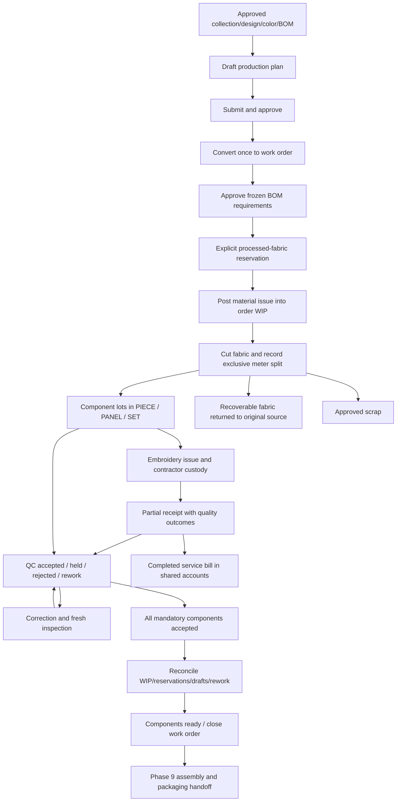

# Phase 8 production workflow

Production connects Phase 7 approved designs to Phase 5 processed-fabric reservations, the shared meter ledger, a separate component count ledger, and Phase 6 contractor accounts. All operations remain frontend-only in the existing localStorage snapshot.

Start at `/production/dashboard`. Navigation exposes plans, orders, material requirements/allocations/issues/returns, cutting, components, embroidery, receipts, QC, rework, wastage, expenses, allowances, costing and reports. Existing `/production`, `/cutting`, `/embroidery` and `/quality-control` routes open the connected screens. Deep links preserve original documents; historical batches remain read-only.

No planning or approval action changes stock. Each physical posting is explicit and confirmed. Forms use Urdu labels and RTL layouts. Tables support filtering, sorting, pagination and CSV export; document details expose A4 print/PDF previews. Global search and notifications link to real source records.

See [order rules](PRODUCTION_WORK_ORDER_RULES.md), [materials](MATERIAL_ALLOCATION_AND_ISSUE.md), [cutting](CUTTING_AND_COMPONENT_LEDGER.md), [embroidery](EMBROIDERY_PRODUCTION_WORKFLOW.md), [QC](PRODUCTION_QC_AND_REWORK.md) and [costing](PRODUCTION_COSTING_RULES.md).
