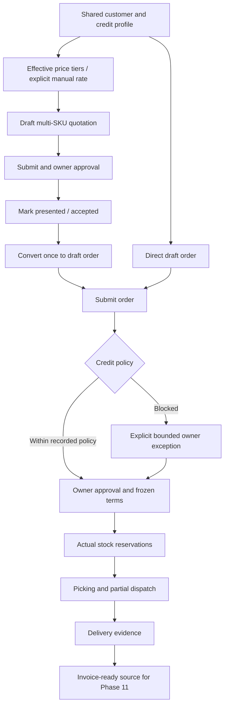

# Quotations and sales orders

Quotation routes are `/sales/quotations`, `/new`, `/:id`; `/quotations` remains an alias. States: DRAFT -> SUBMITTED -> APPROVED -> PRESENTED/ACCEPTED -> CONVERTED. Unconverted documents may be explicitly rejected/cancelled or expired after their last date. Expired documents cannot convert; create/review a fresh quotation. Conversion is atomic and creates one linked draft order. Initial converted values match the approved quote; its original approval snapshot remains referenced even if the draft order is subsequently edited and independently repriced. A quote creates no reservation, physical movement or receivable.

Orders at `/sales/orders` support multiple actual sellable SKUs, customer, warehouse, salesperson, dates, delivery/transport terms, safe pricing/discounts and explicit partial-reservation permission. Drafts may be edited. Submission and owner approval are separate. Approved commercial data is frozen; there is no arbitrary status editor.

Operational states derive from actual documents: APPROVED, PARTIALLY_RESERVED, RESERVED, PARTIALLY_PICKED, PICKED, PARTIALLY_DISPATCHED and DISPATCHED. CLOSED requires no remaining fulfillment and all posted dispatches delivered. Draft/submitted/cancelled/closed states are preserved by the state projection. Existing historical states remain readable, without replay.

An approved unshipped order may be amended by the owner only through cancellation/replacement: pending dispatches/picking claims must first be resolved; unused reservations are explicitly released, the old commercial snapshot is retained, and a new linked draft is created. Partial line cancellation requires unreserved remaining quantity. Order remainder cancellation releases unused claims, records line quantities/reasons, and never reverses posted shipments. A partially shipped order can finish with cancelled remainder while its dispatch history remains intact.

Read [credit control](CUSTOMER_CREDIT_CONTROL.md), [reservation/picking](SALES_RESERVATION_AND_PICKING.md), [dispatch/delivery](DISPATCH_AND_DELIVERY_WORKFLOW.md) and [reconciliation](SALES_RECONCILIATION.md). All forms are transient React Hook Form state until one validated transaction is committed through Zustand/localStorage.
