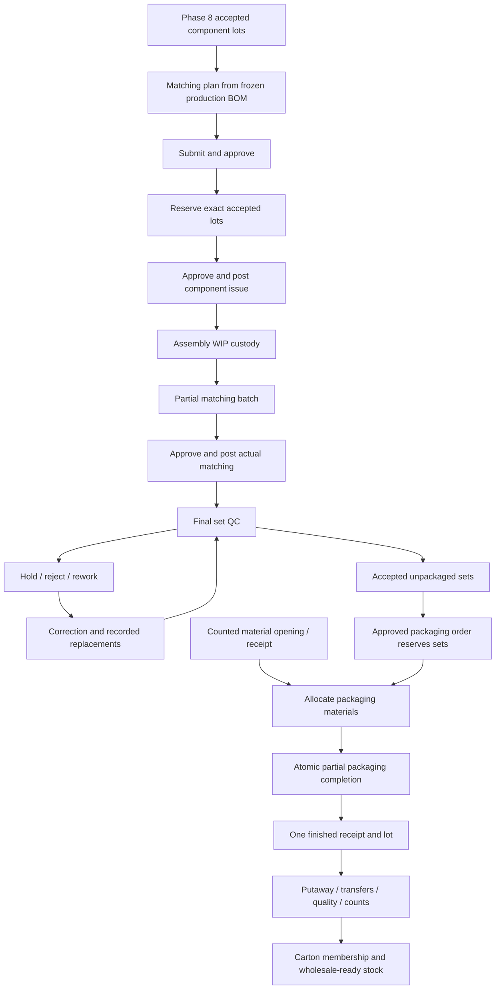

# Suit matching workflow - Phase 9

The assembly module consumes genuine accepted operational Phase 8 components. Historical production/finished snapshots are not converted into fictitious component stock. Start at `/assembly` or `/assembly/dashboard`; the preserved `/suit-assembly` link opens the same module.

Draft plans can be edited. Plans move DRAFT -> SUBMITTED -> APPROVED, with COMPONENTS_RESERVED and PARTIALLY_ASSEMBLED derived from actual documents. An explicit START action retains IN_PROGRESS and cannot be repeated. Completion requires the target matched, unused issued components returned, reservations released, and outstanding drafts/mismatches/rework resolved. A new correction may reopen an assembly plan; it never reopens or rewrites the original closed production order.

Planning and reservations create no physical sets. Approve/post are separate confirmed actions. Matching consumes only the selected actual output quantity. Remaining issued components stay WIP, with controlled returns. Mismatch records identify a missing/incorrect requirement and require valid issued replacement components before correction.

All commands run outside React, return typed success/error, validate one candidate snapshot, append source movements once and persist through the existing Zustand commit boundary. Form editing does not write to localStorage.

See [component rules](ASSEMBLY_COMPONENT_RULES.md), [final QC](FINAL_SUIT_QUALITY_CONTROL.md), [packaging](PACKAGING_WORKFLOW.md), [finished ledger](FINISHED_GOODS_LEDGER.md), [labels/cartons](SKU_BARCODE_AND_CARTON_RULES.md), [costing](FINISHED_GOODS_COSTING.md) and [acceptance](PHASE_9_ACCEPTANCE.md).
